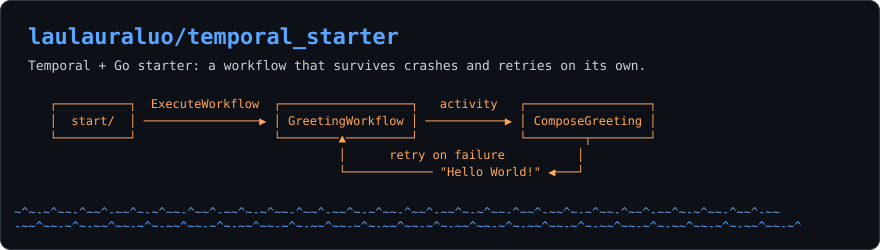
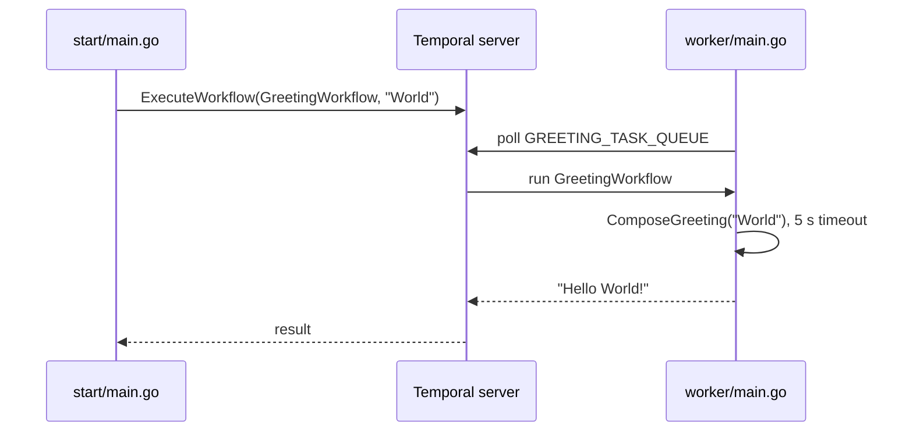

<p align="center">
  <picture>
    <source media="(prefers-color-scheme: dark)" srcset="assets/banner-dark.svg">
    <source media="(prefers-color-scheme: light)" srcset="assets/banner-light.svg">
    
  </picture>
</p>

<p align="center">
  <a href="https://github.com/laulauraluo/temporal_starter/generate"></a>
</p>

<p align="center">
  
  
  
</p>

<p align="center"><sub>A running Temporal skeleton in a few minutes: one workflow, one activity, a worker, a starter, and a unit test.</sub></p>

## ⚡ Quick start

You need Go 1.22+ and the Temporal CLI (`brew install temporal`). Use three terminals:

```bash
# 1. local Temporal server; Web UI at http://localhost:8233
temporal server start-dev
```

```bash
# 2. worker
cd hello-world-temporal
go run worker/main.go
```

```bash
# 3. start one workflow and print its result
cd hello-world-temporal
go run start/main.go
```

Terminal 3 prints the workflow ID, the run ID, and `Hello World!`. The run also shows up in the Web UI.

## 🧭 How it works



The server records every step. If the worker dies mid-run, the next worker that polls the queue picks the workflow up where it stopped, and a failed activity is retried with Temporal's default retry policy.

## ✅ Tests

```bash
cd hello-world-temporal
go test ./...
```

`workflow_test.go` runs the workflow in Temporal's test environment with the activity mocked, so it needs no server.

## 🛠️ Make it yours

| To change | Edit |
|---|---|
| What the work does | `activity.go` (add activities next to `ComposeGreeting`) |
| The order of steps, timeouts, retries | `greetingWorkflow.go` |
| Which workflows and activities run | register them in `worker/main.go` |
| Task queue name | `shared.go` |
| Workflow ID and input | `start/main.go` |
| Module path | `go.mod`, then the imports in `worker/` and `start/` |

## 📁 Layout

```
hello-world-temporal/
├── greetingWorkflow.go   workflow
├── activity.go           activity
├── shared.go             task queue name
├── workflow_test.go      unit test
├── worker/main.go        worker process
└── start/main.go         starts a workflow
```

## 🙏 Credits

Based on Temporal's official [hello-world-project-template-go](https://github.com/temporalio/hello-world-project-template-go), released under the MIT license (see `LICENSE`).
